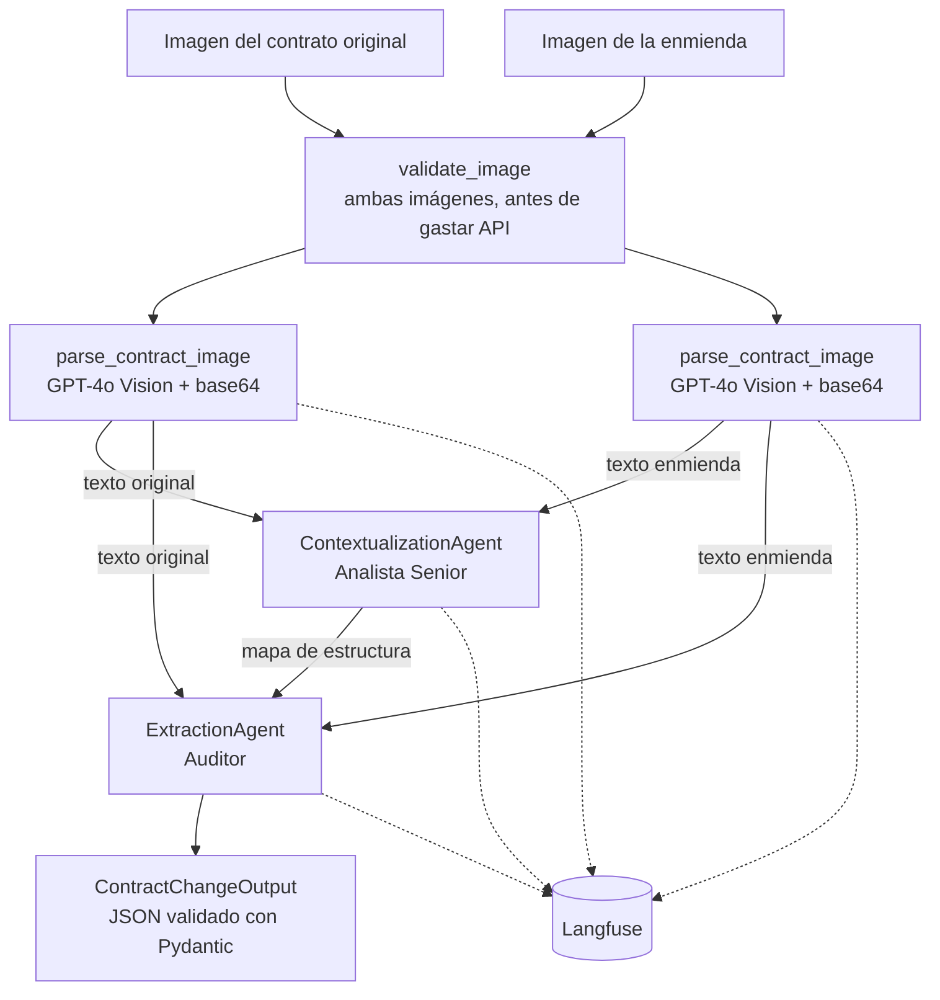

# Multi-Agent Contract Analyzer — LegalMove

Sistema multi-agente que compara la imagen de un contrato con la de su enmienda y devuelve, en un JSON validado, qué secciones cambiaron, qué temas afectan y un resumen de cada cambio.

**Problema:** en LegalMove, revisar una enmienda implica comparar a mano dos documentos escaneados, cláusula por cláusula. Es lento y un cambio de una sola palabra puede pasar inadvertido.

**Solución:** GPT-4o Vision transcribe las imágenes y dos agentes especializados analizan los textos: uno entiende la estructura y el otro audita los cambios. Cada ejecución queda registrada en Langfuse para poder revisarla.

## Arquitectura



### Qué hace cada etapa

| Etapa                       | Archivo                                 | Entrada                  | Salida                                                                      |
| --------------------------- | --------------------------------------- | ------------------------ | --------------------------------------------------------------------------- |
| Validación y parsing        | `src/image_parser.py`                   | Imagen PNG o JPEG        | Texto fiel, respetando cláusulas y secciones                                |
| Agente 1: contextualización | `src/agents/contextualization_agent.py` | Los dos textos           | Mapa que empareja las secciones y señala dónde mirar. No identifica cambios |
| Agente 2: extracción        | `src/agents/extraction_agent.py`        | El mapa y los dos textos | Adiciones, eliminaciones y modificaciones, validadas con Pydantic           |
| Orquestación y trazas       | `src/main.py`                           | Dos paths por argumento  | JSON final y traza en Langfuse                                              |

### Estructura del proyecto

```text
├── data/test_contracts/    # 4 pares de imágenes y su README
├── src/
│   ├── agents/
│   │   ├── contextualization_agent.py
│   │   ├── errors.py       # AgentError y mensajes por tipo de falla
│   │   └── extraction_agent.py
│   ├── config.py           # Configuración desde variables de entorno
│   ├── image_parser.py     # Validación, base64 y llamada a GPT-4o Vision
│   ├── main.py             # Entry point y spans de Langfuse
│   └── models.py           # ContractChangeOutput
├── .env.example
└── requirements.txt
```

## Instalación

Requiere Python 3.14, una API key de OpenAI y una cuenta de [Langfuse](https://cloud.langfuse.com).

```bash
git clone https://github.com/milagrosniro/multi-agent-contract-analyzer.git
cd multi-agent-contract-analyzer
python -m venv .venv
```

Activá el entorno:

```bash
# Windows (PowerShell)
.venv\Scripts\Activate.ps1

# macOS / Linux
source .venv/bin/activate
```

Instalá las dependencias y creá tu archivo de variables:

```bash
pip install -r requirements.txt
cp .env.example .env
```

Completá en `.env` estas variables. Las demás son opcionales y tienen valores por defecto.

| Variable              | Para qué sirve            |
| --------------------- | ------------------------- |
| `OPENAI_API_KEY`      | Clave de OpenAI           |
| `LANGFUSE_PUBLIC_KEY` | Clave pública de Langfuse |
| `LANGFUSE_SECRET_KEY` | Clave secreta de Langfuse |
| `LANGFUSE_HOST`       | URL de Langfuse           |

## Uso

Ejecutá el comando desde la raíz del proyecto:

```bash
python -m src.main <imagen_original> <imagen_enmienda>
```

Ejemplo con el par simple:

```bash
python -m src.main data/test_contracts/documento_4__original.png data/test_contracts/documento_4__enmienda.png
```

Salida:

```json
{
  "sections_changed": ["3. Honorarios"],
  "topics_touched": ["precio", "vencimiento"],
  "summary_of_the_change": "Cláusula 3: la tarifa mensual cambia de USD 2.500 a USD 2.800 y el vencimiento cambia del día 10 al día 5 de cada mes."
}
```

Si algo falla, el programa muestra un mensaje claro y termina con código de salida 1.

## Observabilidad

Cada ejecución genera en Langfuse una traza con esta jerarquía:

```text
contract-analysis
├── parse_original_contract
├── parse_amendment_contract
├── contextualization_agent
└── extraction_agent
```

Cada span registra entrada, salida y latencia. Las llamadas al modelo registran además modelo y tokens. Si una ejecución falla, la traza queda marcada como `ERROR`, con el mensaje correspondiente.

Referencia de una corrida con el par 4: 4.916 tokens y 8 segundos. Más de la mitad de los tokens corresponde a la transcripción de las imágenes.

## Decisiones técnicas

| Decisión                                                  | Por qué                                                                                                                                                                                          |
| --------------------------------------------------------- | ------------------------------------------------------------------------------------------------------------------------------------------------------------------------------------------------ |
| **Dos agentes en lugar de uno**                           | Separar responsabilidades permite prompts especializados y ver en Langfuse en qué etapa aparece un error                                                                                         |
| **El Agente 2 recibe el mapa y los textos**               | El mapa es el índice y los textos son la evidencia. El mapa no incluye montos ni fechas a propósito                                                                                              |
| **GPT-4o Vision para el parsing**                         | Lo exige el caso de uso: lee documentos escaneados y conserva la jerarquía de cláusulas                                                                                                          |
| **SDK de OpenAI para visión, LangChain para los agentes** | La visión es una sola llamada directa. Los agentes usan cadenas de LangChain, como pide el stack del proyecto                                                                                    |
| **`with_structured_output` y Pydantic**                   | Obliga al modelo a responder con el esquema y valida la respuesta, incluido que el resumen no esté vacío                                                                                         |
| **`temperature=0`**                                       | Una auditoría necesita resultados lo más consistentes posible. Reduce la variación, aunque no la elimina                                                                                         |
| **Spans manuales y `CallbackHandler`**                    | Los spans reproducen las 4 etapas del negocio y el handler captura los tokens de LangChain. No se usa `langfuse.openai` porque intercepta todas las llamadas a OpenAI y duplica las de LangChain |
| **Validar las dos imágenes antes de la primera llamada**  | Si un archivo es inválido, se corta el proceso sin gastar API                                                                                                                                    |
| **Los documentos se tratan como datos**                   | Los prompts ordenan ignorar cualquier instrucción escrita dentro de un contrato                                                                                                                  |
| **PNG en las imágenes de prueba**                         | Comprime sin pérdida y mantiene el texto más nítido                                                                                                                                              |

## Manejo de errores

| Situación                                                   | Comportamiento                                                                  |
| ----------------------------------------------------------- | ------------------------------------------------------------------------------- |
| Archivo inexistente, formato no soportado o imagen corrupta | Corta antes de llamar a la API                                                  |
| Falta `OPENAI_API_KEY` o una variable numérica es inválida  | Indica qué variable corregir                                                    |
| Timeout, conexión o rate limit                              | Reintenta hasta `OPENAI_MAX_RETRIES` veces. Si sigue fallando, informa la causa |
| Clave rechazada por OpenAI                                  | Pide revisar `OPENAI_API_KEY`                                                   |
| Límite de tokens                                            | Informa que los documentos o la respuesta lo superan                            |
| Respuesta que no cumple el esquema                          | Informa el error de validación de Pydantic                                      |
| Claves de Langfuse ausentes                                 | El análisis termina igual, pero no registra la traza                            |

## Resultados

Probado con los 4 pares de [`data/test_contracts/`](data/test_contracts/README.md), comparando contra el documento oficial de diferencias:

| Par | Contrato                   | Cambios oficiales | Detectados |
| --- | -------------------------- | ----------------- | ---------- |
| 1   | Licencia de Software       | 5                 | 5          |
| 2   | Servicios de Consultoría   | 5                 | 5          |
| 3   | SaaS                       | 3                 | 3          |
| 4   | Mantenimiento (par propio) | 2                 | 2          |

En el par 1 también detecta un cambio en la cláusula 1 que el documento oficial no lista.
